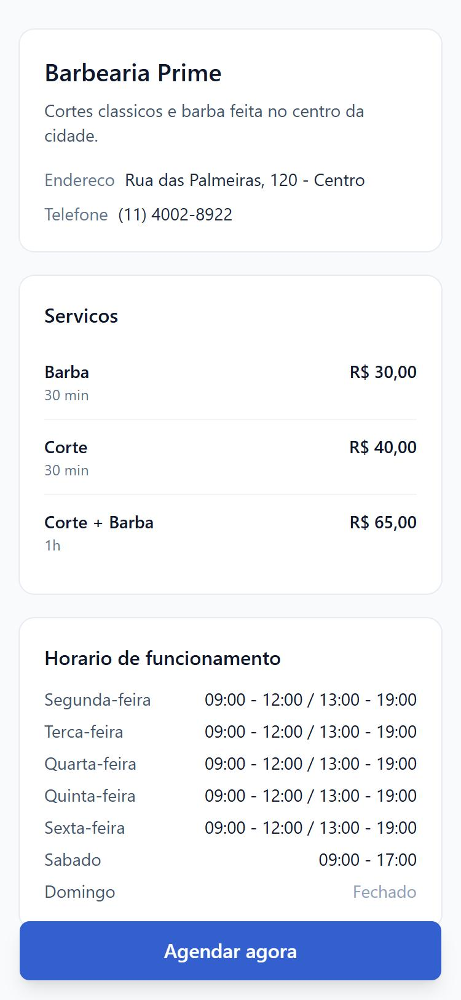
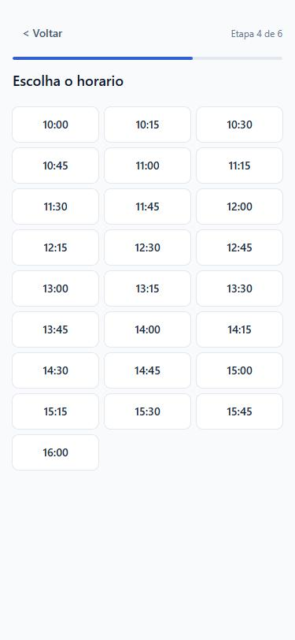
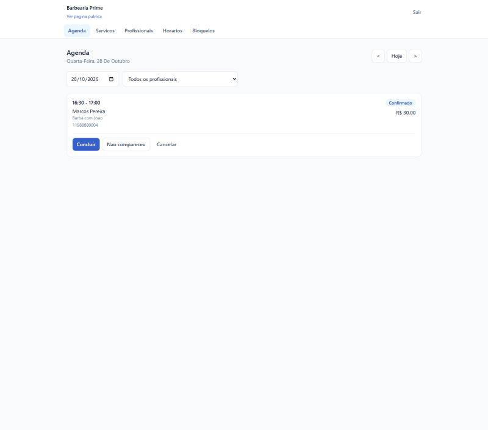
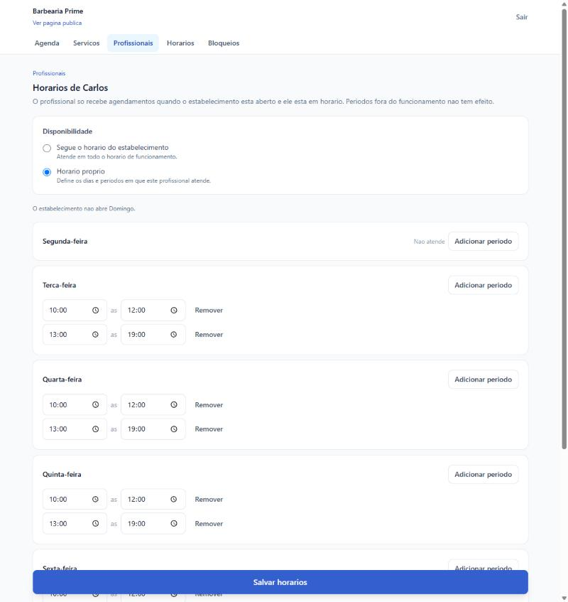

# Agendamento online

Sistema de agendamento para prestadores de servico — barbearias, saloes, clinicas e estudios.
O cliente abre um link, escolhe servico, profissional, dia e horario, e confirma em poucos toques.
O dono do estabelecimento acompanha a agenda do dia e mantem o catalogo em um painel proprio.

Esta e a versao basica e publica do projeto: poucas funcionalidades, feitas por inteiro e
funcionando de ponta a ponta.

| Pagina publica | Escolha de horario | Agenda do dia | Horario do profissional |
| --- | --- | --- | --- |
|  |  |  |  |

## Funcionalidades

**Pagina publica** (`/agendar/{slug}`), pensada para quem chega pelo link do WhatsApp:

- dados do estabelecimento, lista de servicos com preco e duracao, e horario de funcionamento;
- fluxo de agendamento com uma etapa por tela: servico, profissional, data, horario, dados do
  cliente e resumo antes de confirmar;
- calendario que desabilita dias fechados e datas passadas;
- horarios calculados pelo backend, considerando a duracao do servico;
- pagina de sucesso com o resumo e botao para baixar um arquivo `.ics` gerado no navegador;
- se o horario for ocupado entre a escolha e a confirmacao, o cliente recebe uma mensagem clara e
  volta para a etapa de horario.

**Painel do dono** (autenticado):

- cadastro e login — o cadastro cria o usuario e o estabelecimento com seu slug;
- agenda do dia com navegacao entre dias e filtro por profissional;
- mudanca de status: `CONFIRMED` para `COMPLETED`, `CANCELLED` ou `NO_SHOW`;
- CRUD de servicos e de profissionais, incluindo quais servicos cada um realiza;
- horario de funcionamento por dia da semana, com dia fechado e mais de um periodo por dia;
- horario proprio por profissional, com dias de folga e mais de um periodo por dia, ou seguindo
  o horario do estabelecimento;
- bloqueios por periodo, para um profissional ou para o estabelecimento inteiro.

## Stack

**Backend:** Java 21, Spring Boot 3.3, Spring Security com JWT, Spring Data JPA, PostgreSQL 16,
Flyway, Bean Validation, springdoc-openapi.
**Frontend:** React 18, TypeScript, Vite, Tailwind CSS 4, React Router, TanStack Query,
React Hook Form, Zod.
**Infra:** Docker e Docker Compose.
**Testes:** JUnit 5, Testcontainers, Vitest, Testing Library.

```
backend/    API Spring Boot, organizada por dominio
frontend/   SPA React, organizada por funcionalidade
docs/       screenshots
```

## Como rodar

Com Docker (sobe banco, backend e frontend):

```bash
cp .env.example .env
docker compose up --build
```

- Pagina publica de demonstracao: <http://localhost:5173/agendar/barbearia-prime>
- Painel: <http://localhost:5173/login>
- API e Swagger: <http://localhost:8080/swagger-ui>

Usuario de demonstracao: **demo@barbeariaprime.com** / **demo1234**. Nos dados de demonstracao o
Joao segue o horario da barbearia e o Carlos tem horario proprio, para ver a diferenca na pagina
publica.

Sem Docker, com um PostgreSQL proprio:

```bash
cd backend && mvn spring-boot:run
cd frontend && npm install && npm run dev
```

O backend exige `JWT_SECRET` definido; nao ha valor padrao.

## Variaveis de ambiente

Todas estao em `.env.example`. Nenhum segredo fica no codigo.

| Variavel | Para que serve |
| --- | --- |
| `POSTGRES_DB` / `POSTGRES_USER` / `POSTGRES_PASSWORD` / `POSTGRES_PORT` | banco de dados |
| `BACKEND_PORT` / `FRONTEND_PORT` | portas publicadas no host |
| `SPRING_PROFILES_ACTIVE` | `demo` popula os dados de demonstracao; vazio sobe limpo |
| `JWT_SECRET` | chave HMAC de assinatura dos tokens, com no minimo 32 bytes (obrigatoria) |
| `JWT_EXPIRATION_MINUTES` | validade do access token (padrao 480) |
| `SLOT_INTERVAL_MINUTES` | intervalo entre horarios oferecidos (padrao 15) |
| `CORS_ALLOWED_ORIGINS` | origens liberadas para o frontend |
| `VITE_API_URL` | URL da API usada pelo frontend |

## Decisoes de arquitetura

### Multi-tenancy desde o inicio

Banco compartilhado, com `business_id` em todas as tabelas de dados do estabelecimento. No painel,
o `business_id` sai sempre do JWT — nunca do corpo ou da URL — e todas as consultas filtram por ele:
os repositorios so expoem metodos como `findByIdAndBusinessId`. Acessar recurso de outro
estabelecimento retorna 404, nao 403, para nao confirmar a existencia do recurso. Nas rotas
publicas o estabelecimento e resolvido pelo `slug`.

### Fuso horario

Agendamentos e bloqueios sao gravados como `timestamptz`. Cada estabelecimento tem um campo
`timezone` (padrao `America/Sao_Paulo`). O horario de funcionamento e gravado como `LocalTime` mais
dia da semana e so vira instante quando interpretado no fuso do estabelecimento. O calculo de
horarios nunca usa o fuso do servidor, e o "agora" vem de um `Clock` injetado, o que torna o caso
"horario ja passou" testavel.

### Prevencao de double booking

Duas camadas, porque uma nao basta:

1. **Revalidacao transacional** — no momento da criacao, dentro da transacao, os horarios
   disponiveis sao recalculados e o escolhido e conferido de novo.
2. **Exclusion constraint no PostgreSQL** — a garantia definitiva, no banco:

   ```sql
   EXCLUDE USING gist (
       professional_id WITH =,
       tstzrange(starts_at, ends_at) WITH &&
   ) WHERE (status <> 'CANCELLED')
   ```

   Nenhum caminho da aplicacao, nem um script manual, consegue gravar dois agendamentos ativos
   sobrepostos para o mesmo profissional. A violacao chega como SQLSTATE `23P01` e o handler global
   a traduz em **409 Conflict** com uma mensagem que o cliente entende.

Em testes de carga, porem, varias requisicoes simultaneas para o mesmo horario ficavam presas
esperando o insert especulativo umas das outras, e o PostgreSQL resolvia a disputa como *deadlock* —
um erro 500 feio para quem so perdeu a corrida. Por isso o agendamento toma antes um
`pg_advisory_xact_lock` por profissional: as tentativas sao serializadas, quem perde simplesmente
encontra o horario ocupado na revalidacao e recebe 409. A exclusion constraint continua no lugar,
como ultima linha de defesa.

### Motor de disponibilidade

A regra vive em `AvailabilityEngine`, uma classe de dominio pura: sem banco, sem relogio do sistema,
recebendo tudo ja carregado. Horarios livres = periodos em que o profissional pode ser agendado no
dia, menos os agendamentos ativos dele, menos os bloqueios dele e do estabelecimento, menos o que ja
passou — sempre considerando a duracao do servico, de modo que um horario so aparece se o servico
couber inteiro antes do fim do periodo.

Os periodos agendaveis vem do cruzamento de duas agendas. Um profissional sem horario proprio
atende em todo o funcionamento do estabelecimento; com horario proprio, atende apenas na
intersecao entre os dois — nunca fora do funcionamento, nunca fora do seu turno. Ter zero linhas em
`professional_hours` e o estado que significa "segue o estabelecimento", o que evita no banco a
contradicao entre "segue o funcionamento" e "atende so nestes periodos".

### API

DTOs em todas as entradas e saidas, nunca entidades JPA. Erros respondem em `ProblemDetail`
(RFC 7807) vindos de um handler global. Rotas publicas em `/api/public/**`, painel em `/api/**`
autenticado, e 401 — nao 403 — quando falta o token.

## Migrations

Flyway, em `backend/src/main/resources/db/migration`, aplicadas no startup. A `V1__init.sql` cria o
modelo completo, habilita as extensoes `pgcrypto` e `btree_gist` e instala a exclusion constraint.
A `V2__professional_hours.sql` adiciona o horario proprio de cada profissional.
O Hibernate roda com `ddl-auto: validate`: o schema e do Flyway.

## Testes

```bash
cd backend && mvn test      # exige Docker em execucao (Testcontainers)
cd frontend && npm test
```

Backend (37 testes):

- **motor de disponibilidade** — dia fechado, varios periodos, servico que nao cabe antes do
  fechamento, agendamento existente, agendamento cancelado liberando o horario, bloqueio cobrindo o
  periodo, horarios passados e resolucao no fuso do estabelecimento;
- **horario do profissional** — turno que estreita o funcionamento, turno que nao pode ultrapassa-lo,
  folga do profissional em dia aberto, varios periodos nas duas agendas, e os horarios publicados
  antes e depois de salvar um turno;
- **double booking** — teste de integracao com PostgreSQL real via Testcontainers, disparando oito
  requisicoes concorrentes para o mesmo horario: exatamente uma recebe 201 e as demais 409;
- **isolamento entre tenants** — o estabelecimento A recebe 404 ao ler, alterar ou remover recursos
  do B, e so enxerga as proprias linhas nas listagens;
- **autenticacao** — rotas protegidas respondem 401 sem token e com token invalido.

Frontend (8 testes): o fluxo publico de ponta a ponta com requisicoes simuladas — inclusive o caso
em que o horario e tomado entre a escolha e a confirmacao e o calendario de um profissional que nao
atende nos dias abertos — e a geracao do arquivo `.ics`.

> O Docker Engine 29 recusa as chamadas sem versao de API que o docker-java envia por padrao; por
> isso o `pom.xml` fixa `api.version` para o Testcontainers.

## Principais endpoints

Documentacao completa e navegavel em `/swagger-ui`.

| Metodo | Rota | Descricao |
| --- | --- | --- |
| `POST` | `/api/auth/register` | cria o dono e o estabelecimento, devolve o token |
| `POST` | `/api/auth/login` | autentica e devolve o token |
| `GET` | `/api/public/businesses/{slug}` | dados publicos, servicos e horario de funcionamento |
| `GET` | `/api/public/businesses/{slug}/services/{id}/professionals` | profissionais que fazem o servico |
| `GET` | `/api/public/businesses/{slug}/availability` | horarios livres de um dia |
| `POST` | `/api/public/businesses/{slug}/appointments` | cria o agendamento |
| `GET` | `/api/appointments?date=&professionalId=` | agenda do dia |
| `PATCH` | `/api/appointments/{id}/status` | muda o status do agendamento |
| `GET` `POST` `PUT` `DELETE` | `/api/services` | catalogo de servicos |
| `GET` `POST` `PUT` `DELETE` | `/api/professionals` | profissionais e seus servicos |
| `GET` `PUT` | `/api/professionals/{id}/hours` | horario proprio do profissional |
| `GET` `PUT` | `/api/business-hours` | horario de funcionamento |
| `GET` `POST` `PUT` `DELETE` | `/api/blocks` | bloqueios |
| `GET` `PUT` | `/api/business` | dados do estabelecimento |

## Fora do escopo desta versao

Nao implementado, mas nada na arquitetura impede: refresh token e recuperacao de senha;
agendamento sem profissional especifico; notificacoes
por WhatsApp ou e-mail; visao semanal e metricas; busca e filtros avancados; upload de logo; planos
e pagamentos; dominio personalizado; integracao com Google Calendar; cancelamento pelo proprio
cliente.
